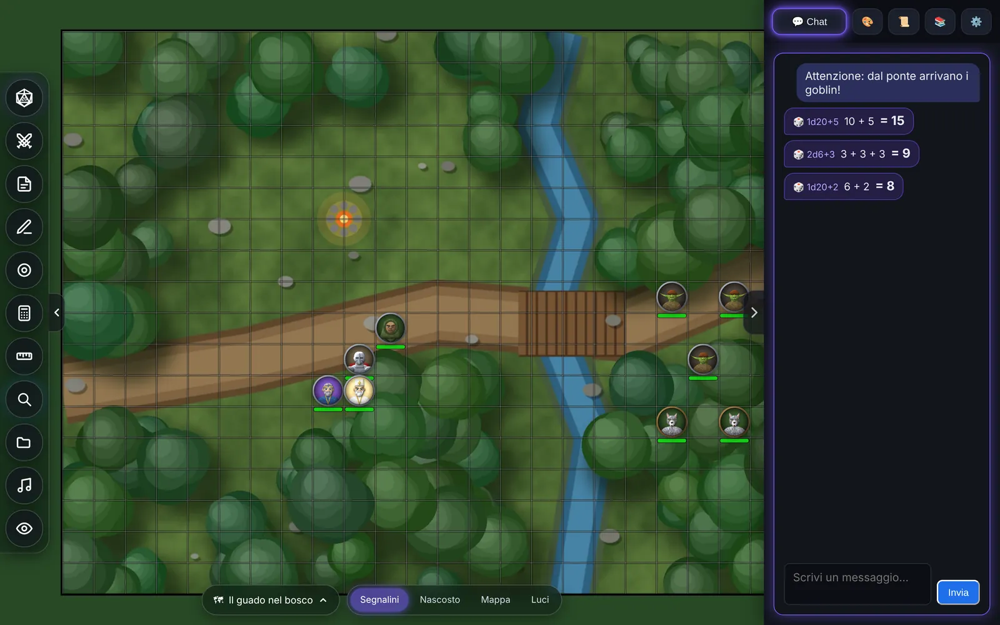
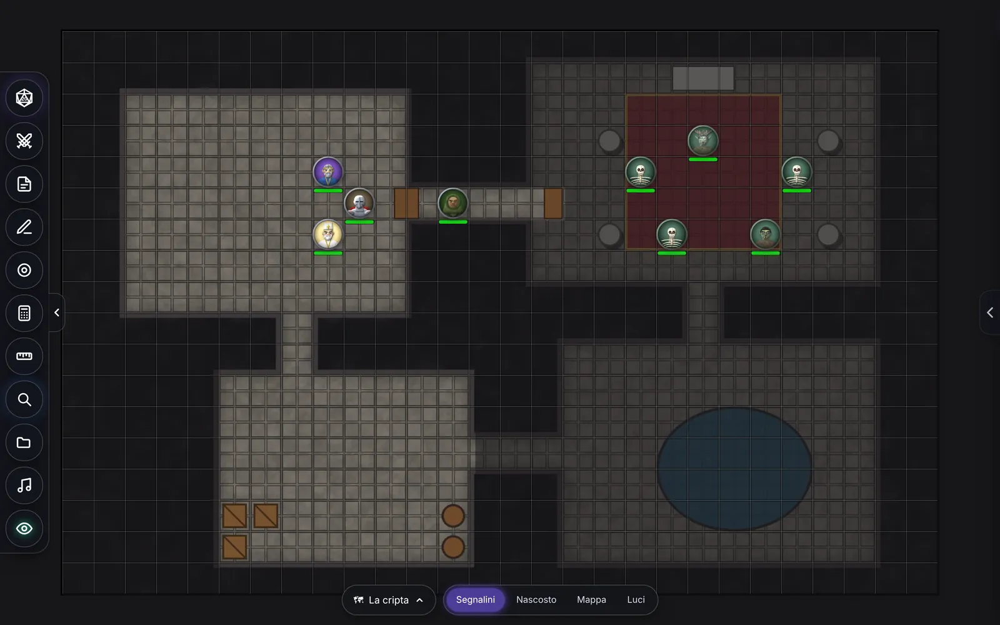
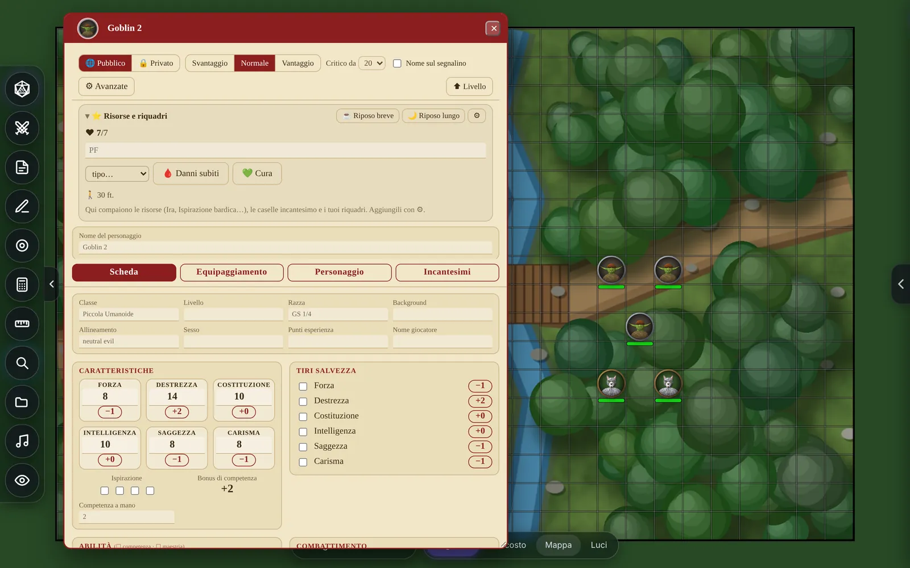

# LIBRE VTT

[English](README.md) · **Italiano**

## Download

Un clic su un pulsante scarica quel file dall'ultima versione. Il numero dice quante volte è stato scaricato.

| Sistema | Scegli questo | Va su tutti (pesa di più) |
|---|---|---|
| **Windows 10/11** |   |   |
| **Mac** (macOS 11+) |   |  |
| **Linux** |    |  |
| **Android** 7+ |  |  |
| **iPhone e iPad** (iOS 15+) |   | |

Non sai quale? Su Windows quasi tutti i PC sono **x64** (ARM64 è per i PC Snapdragon). Sul Mac, menu Mela ›
*Informazioni su questo Mac*: «Chip» vuol dire **Apple Silicon**, «Processore» vuol dire **Intel**. Su Linux te lo
dice `uname -m`. Quasi tutti i telefoni di oggi sono **arm64**. Gli altri file della release (`uffa-link-…`,
`.sha256`, `SHA256SUMS.txt`) li usa l'app da sola: non serve mai scaricarli.

Tavolo da gioco virtuale che gira sul tuo computer.

C'è anche una **versione sito web**: con «Partita pubblica» accesa nell'app del master, i giocatori entrano
dal browser con il suo codice, senza installare niente (vedi [docs/sito-web.md](docs/sito-web.md)).

| La nebbia di guerra (il master vede attraverso il velo) | Le schede, collegate ai segnalini |
|---|---|
|  |  |

Mappe disegnate per queste immagini; segnalini dell'SRD inclusi nel programma.

**Segnalazioni e idee**: apri una [segnalazione](https://github.com/EDG-coder/Libre-VTT/issues/new/choose).
Per contribuire leggi [CONTRIBUTING.md](CONTRIBUTING.md); per un problema di sicurezza
[SECURITY.md](SECURITY.md); per l'accessibilità [ACCESSIBILITY.md](ACCESSIBILITY.md).

## Come si avvia

### macOS: `LIBRE-VTT-Mac-AppleSilicon.dmg` o `LIBRE-VTT-Mac-Intel.dmg`

Il primo per i Mac con chip Apple (M1, M2…), il secondo per quelli Intel. Se non sai quale hai
(menu Mela › *Informazioni su questo Mac*, voce «Chip» o «Processore»), `LIBRE-VTT.dmg` va su tutti e due
ma pesa di più.

1. Apri il **.dmg** e trascina **LIBRE VTT** su **Applicazioni**. Fine: dentro c'è tutto,
   niente cartelle sparse.
2. La prima volta macOS dice che l'app viene da uno sviluppatore che non conosce (non è firmata
   da Apple). Vai in **Impostazioni di Sistema → Privacy e sicurezza**, in fondo, e premi
   **Apri comunque**. Si fa una volta sola.
3. Se sul Mac non c'è Node.js, LIBRE VTT ti chiede il permesso e lo scarica da solo dal sito
   ufficiale (circa 45 MB, controllandone l'integrità). Se c'è già, lo usa e basta.

Le campagne vanno in **Documenti › LIBRE VTT › Campagne**; il resto in
`~/Library/Application Support/LIBRE VTT` e il registro dell'avvio in `~/Library/Logs/LIBRE VTT`.
Dentro l'app non si scrive mai, quindi funziona anche lanciata direttamente dal disco del .dmg.

### Windows: `LIBRE-VTT-Setup-x64.exe` (o `Installa LIBRE VTT.cmd`)

`LIBRE-VTT-Setup-x64.exe` per quasi tutti i PC; `LIBRE-VTT-Setup-ARM64.exe` per i PC ARM
(Snapdragon). `LIBRE-VTT-Setup.exe` va su tutti e due ma pesa di più.

Doppio clic e **Installa**. Non servono permessi da amministratore e non serve avere già niente:
funziona su un Windows appena installato. Alla fine trovi LIBRE VTT nel menu Start e sul desktop; si
toglie da *Impostazioni › App › App installate*. Windows la prima volta può avvisare che il file
viene da internet: «Esegui comunque» / «Ulteriori informazioni › Esegui».

### Linux: `Installa-LIBRE-VTT-Linux-x64.sh` (o `-arm64.sh`, `-riscv64.sh`)

Uno per processore: `x64` per i PC Intel/AMD, `arm64` per ARM (es. Raspberry Pi a 64 bit),
`riscv64` per RISC-V (`uname -m` te lo dice). `Installa-LIBRE-VTT-Linux.sh` li ha dentro tutti.
Serve `xz` per estrarlo, che c'è in quasi tutte le distribuzioni (altrimenti basta python3).

Tasto destro › *Esegui come programma* (o `bash Installa-LIBRE-VTT-Linux.sh`). Niente password,
niente pacchetti di sistema: alla fine LIBRE VTT è nel menu delle applicazioni e sulla Scrivania; si
toglie dal menu (tasto destro sull'icona › *Disinstalla LIBRE VTT*). Con zenity o kdialog (GNOME,
KDE…) usa le finestre grafiche, altrimenti fa tutto nel terminale.

Per una macchina senza schermo che fa solo da **server dedicato** (vedi più giù):
`bash Installa-LIBRE-VTT-Linux.sh --server`.

### Dove si installa, e perché non dà fastidio al resto

Su Windows e Linux tutto finisce in **una sola cartella privata**:
`%LOCALAPPDATA%\LIBRE VTT` su Windows, `~/.local/share/libre-vtt` su Linux.

    app/        il programma
    runtime/    il suo Node.js, scaricato da nodejs.org e controllato (o già dentro l'installatore)
    utente/     impostazioni, collegamento a distanza e, se servono, gli strumenti per costruirlo

LIBRE VTT usa solo quello che c'è lì dentro: non guarda e non tocca Node, Rust, Python o altro
installato sul computer, non cambia il PATH, ignora variabili come `NODE_OPTIONS` o `RUSTFLAGS`
lasciate da altri programmi, e se le porte di sempre (3000, 4000, 4100) sono occupate da altri
programmi ne usa altre e se le ricorda. Disinstallando si toglie tutta la cartella; **le campagne
in Documenti › LIBRE VTT restano**.

### Il collegamento a distanza

Serve per «Conduco io» e «Mi unisco». LIBRE VTT lo prende così, al primo bisogno e dopo averlo
chiesto:

1. se è già dentro l'installatore (quelli fatti da GitHub ce l'hanno), è subito pronto;
2. altrimenti lo **scarica già pronto** dalla pagina «Releases» del progetto su GitHub
   (`rilascio.json` dice quale), controllandone l'impronta SHA-256: pochi MB;
3. se non c'è, lo **costruisce sul posto** con strumenti privati: Rust e Zig (che fa da
   compilatore C, così non servono né Visual Studio né build-essential) scaricati nella cartella
   di LIBRE VTT. Circa 200 MB da scaricare e 5-15 minuti, una volta sola.

### Altri modi (cartella del progetto)

| sistema | che cosa apri |
|---|---|
| Windows | `avvio/LIBRE VTT.vbs` (la prima volta crea nella cartella principale `LIBRE VTT.lnk` con l'icona: poi usa quello) |
| Linux | `avvio/LIBRE VTT.desktop` (o `avvio/avvia-app.sh`) |
| macOS | `avvio/LIBRE VTT.app` (versione «ponte», vedi sotto) |

Così serve **Node** già installato ([nodejs.org](https://nodejs.org), versione LTS).

### Che cosa succede quando si apre

Una finestra senza barre del browser con tre scelte:

- **Gioco da solo** — solo questo computer.
- **Conduco io** — apre la partita e ti dà il codice da mandare agli altri.
- **Mi unisco** — incolli il codice e sei dentro.

Per «Gioco da solo» e «Conduco io» ti chiede prima **quale campagna** (vedi sotto).

La prima volta che scegli «Conduco io» o «Mi unisco», serve un pezzo in più per far parlare i
computer fra loro. L'app te lo dice, ti chiede il permesso (ti dice anche quanto occupa) e poi
fa tutto da sola: scarica Rust se manca, compila, e riprende da dove eri. Ci vogliono alcuni
minuti, **una volta sola per computer**. Nessun terminale, nessun comando.

> Su Windows, se la compilazione si ferma, di solito mancano i *Visual Studio C++ Build Tools*:
> la finestra te lo scrive con il link. Si installano una volta e basta.

Chiudendo la finestra si spegne tutto. Se riapri LIBRE VTT quando è già aperto, ti mostra la
finestra che c'è già invece di accenderne un'altra.

### `LIBRE VTT.app` nella cartella: un «ponte» (macOS)

Se usi la cartella invece del .dmg: puoi tenere `LIBRE VTT.app` dov'è oppure trascinarla in
**Applicazioni**. Se la sposti, **la prima volta** ti chiede dov'è la cartella del gioco e se la
ricorda. Se poi scompatti una versione nuova, **«avvio/Cambia cartella collegata (macOS).command»** le
fa dimenticare quella vecchia. Se cliccandola non succede proprio niente, lo zip ha perso il
permesso di esecuzione: in Terminale `chmod +x ` + trascina `LIBRE VTT.app` + `/Contents/MacOS/libre-vtt`,
Invio, una volta sola. Il registro è in `libre-vtt-avvio.log` nella cartella del gioco.

### Se preferisci fare a mano

Gli avviatori di prima ci sono ancora, in `avvio/`: `start.command` / `start.bat` (da solo),
`avvia-master.*` e `avvia-giocatore.*` (a distanza), e il classico `node server/server.js`
(`CAMPAIGN_DIR=/percorso/campagna node server/server.js` per usare una campagna).
Con npm: `npm start` (il tavolo da solo, come `start.*`), `npm run app` (la finestra di avvio) e
`npm run server` (il server dedicato).

## Le campagne

Una campagna è **una cartella**: dentro ci sono `data/` (scene, schede, chat, giocatori e
permessi) e `assets/` (le immagini). Quando accendi «Gioco da solo» o «Conduco io» scegli:

- una delle **recenti** (in cima l'ultima usata, con quante scene, schede e immagini ha);
- **＋ Nuova campagna**: le dai un nome e finisce in *Documenti › LIBRE VTT › Campagne*;
- **📂 Apri una cartella…**: qualsiasi cartella, per esempio la campagna che ti ha dato un
  amico su una chiavetta. Chi la apre **la conduce lui**; i giocatori di prima, se rientrano,
  ritrovano le loro schede (sono riconosciuti dal loro computer, non dal nome).

Per passare una campagna a qualcuno basta copiargli la cartella (📂 nell'elenco la apre nel
Finder o in Esplora risorse). «✕» la toglie solo dall'elenco: la cartella resta dov'è.
Se scegli una cartella che non è una campagna te lo chiede prima, e ci aggiunge solo `data/` e
`assets/` senza toccare il resto. La campagna che avevi prima delle campagne (dentro la cartella
del gioco) compare nell'elenco come «La campagna di prima».

## I plugin

Temi, pacchetti del compendio e funzioni nuove fatti da chiunque. Stanno in **Documenti › LIBRE VTT › Plugins**
(una cartella per plugin, con dentro un `plugin.json`) e si gestiscono dalla rotellina ⚙ della home:
*Impostazioni › Plugin › Gestisci i plugin*. Una spunta li applica al tavolo, anche già aperto; le frecce
decidono l'ordine; *＋ Crea* parte da un modello pronto. Il codice gira in una sandbox senza internet, a meno che il
plugin chieda l'accesso completo: in quel caso LIBRE VTT lo applica solo dopo due avvisi. Come si fanno: [docs/plugins.md](docs/plugins.md).

## Se cade la connessione

Se il collegamento cade mentre l'app è aperta (wifi, portatile in pausa, il master che riavvia),
in alto compare «mi ricollego da solo…» e LIBRE VTT continua a provare **finché non torna**, senza
limite di tentativi. Quando rientri hai lo stesso nome, gli stessi permessi e le stesse schede.
Nel frattempo resti giocatore: non diventi master per sbaglio, e la chat ti avvisa invece di
perdere i messaggi.

Non riprova solo se ti sei **scollegato tu** (Impostazioni → Sessione → *Scollegati*, o *Smetti*
nell'avviso) o se il master ti ha allontanato. *Collegati adesso* ti rimette dentro.
Anche i pezzi dietro le quinte (server, collegamento) si riaccendono da soli se si fermano.

## Server dedicato (una macchina sempre accesa, senza schermo)

Per avere la partita sempre aperta, come su un sito, ma a casa propria: una schedina che consuma
pochi watt (ARM a 64 bit o RISC-V, per esempio un Raspberry Pi o una Orange Pi), un vecchio
portatile o un server. Lì gira solo la parte che **collega**: la campagna, il server di gioco e il
collegamento a distanza. Nessuno gioca da lì: **tutti**, master compreso, entrano dal proprio
LIBRE VTT con «Mi unisco» e il codice della partita.

    bash Installa-LIBRE-VTT-Linux.sh --server      # oppure, dalla cartella del progetto:
    node server/server-dedicato.js                 # (npm run server)

All'avvio scrive due cose: il **codice della partita** (da mandare a tutti) e la **chiave del
master**. Chi conduce, la prima volta, in «Mi unisco» apre *Conduco io su un server dedicato* e
scrive la chiave sotto il codice: il server lo fa master e da lì in poi lo riconosce dalla sua
identità firmata, senza chiave. Dal suo **pannello della sessione** il master può dare il ruolo di
master anche ad altri (il server tiene sempre almeno un master). Senza la chiave, o con quella
sbagliata, si entra da giocatore. Chi si siede alla macchina del server non diventa master.

Il master entrato da fuori prende **il mondo del server** (scene, schede, note, turni, sistema di
gioco) e lo modifica da lì; il compendio è quello della campagna sul server, che vede come lo
vedono i giocatori. Per portare sul server una campagna già giocata, se ne copia la cartella
(*Documenti › LIBRE VTT › Campagne › nome*) e si avvia con `--campagna <cartella>`: le immagini
che il mondo cita vengono messe nel deposito all'avvio.

Comandi utili (con l'installatore: `~/.local/share/libre-vtt/avvia-server <comando>`):

| comando | che cosa fa |
|---|---|
| `codice` | il codice della partita |
| `chiave` / `nuova-chiave` | la chiave del master / una nuova (la vecchia non vale più; chi è già master lo resta) |
| `giocatori` | chi c'è nel registro, con il ruolo e chi è collegato |
| `master <nome>` / `giocatore <nome>` | dà o toglie il ruolo di master (anche a server acceso) |

Opzioni: `--campagna <cartella>` (predefinita `~/libre-vtt-server`), `--porta`, `--porta-link`,
`--collegamento <uffa-link>`. Il collegamento lo trova nell'installazione, oppure lo scarica dalla
pagina delle release controllandone l'impronta. Con l'installatore parte da solo come servizio
dell'utente (`systemctl --user status libre-vtt-server`); perché parta all'accensione anche senza
entrare con l'utente: `sudo loginctl enable-linger $USER`, una volta sola.

## Creare gli installatori

### Con GitHub (consigliato): tutto dentro, niente da scaricare per chi installa

1. Metti la cartella del progetto su GitHub (il file `.gitignore` tiene fuori campagne e immagini
   tue).
2. Su GitHub: *Releases › Draft a new release*, scrivi un tag che comincia con «v» (es. `v3.0`) e
   premi *Publish*.
3. *Actions* fa il resto (circa 15 minuti): compila il collegamento a distanza per Windows (x64 e
   ARM), Linux (x64, ARM e RISC-V) e Mac, e mette nella release `LIBRE-VTT-Setup.exe`, `Installa-LIBRE-VTT-Linux.sh`,
   `Installa-LIBRE-VTT-Windows.cmd` e `LIBRE-VTT.dmg`, ognuno con dentro Node e il collegamento,
   più una versione più leggera per ogni processore (`LIBRE-VTT-Setup-x64.exe`, `LIBRE-VTT-Mac-AppleSilicon.dmg`,
   `Installa-LIBRE-VTT-Linux-arm64.sh`…).
   Da lì in poi le app scaricano il collegamento da questa release.

Senza tag (*Actions › Rilascio › Run workflow*) costruisce tutto lo stesso e lo lascia scaricabile
dalla pagina dell'esecuzione, senza pubblicare.

### A mano

- `python3 pacchetti/installer/crea-installer.py` → `installatori/` con l'installatore per Linux e quello
  per Windows (`.cmd`). Questi scaricano Node durante l'installazione.
- **Mac, su un Mac**: doppio clic su `pacchetti/mac/Crea il DMG.command` (dmg compresso, con Node e, se c'è
  Rust, il collegamento già compilato).
- **Mac, senza un Mac**: `python3 pacchetti/mac/crea-dmg-senza-mac.py` (immagine ISO 9660 con Rock Ridge,
  che macOS apre come un .dmg).

## Com'è fatto dentro

| pezzo | che cosa fa | dove |
|---|---|---|
| `server/launcher.js` | la finestra di avvio, accende e spegne il resto | `127.0.0.1:4100` |
| `server/server.js` | serve i file del VTT e le immagini | `127.0.0.1:3000` |
| `server/game-server.js` | **decide**: permessi, tiri di dado, chi vede cosa | `127.0.0.1:4000` |
| `server/server-dedicato.js` | il server dedicato: server di gioco e collegamento, senza finestre | — |
| `pacchetti/uffa-link` | porta i byte da una macchina all'altra con iroh | `127.0.0.1:4010` |

### Le cartelle del progetto

| cartella | che cosa c'è |
|---|---|
| `avvio/` | gli avviatori per usare il progetto così com'è (`.vbs`, `.desktop`, `.app`, `start.*`, `avvia-*`) |
| `server/` | i programmi che girano con Node: avviatore, tavolo, server di gioco |
| `condiviso/` | il codice usato sia dal server sia dal browser (luce dinamica, pulizia degli SVG, versioni del mondo) e, in `token-srd/`, i segnalini dei mostri dell'SRD: restano qui perché le campagne salvate li citano con questo percorso |
| `web/` | le pagine: `index.html` (il tavolo), `launcher.html`, `panel.html`, le icone |
| `web/css/` | gli stili |
| `web/js/base/` | il cuore del tavolo: mappa, strumenti, rete, telefono, lingue |
| `web/js/mappa/` | nebbia, luce dinamica, miniature delle scene, segnalini |
| `web/js/strumenti/` | musica, note, ordine dei turni |
| `web/js/schede/` | le schede dei personaggi, i PDF, Roll20, la creazione guidata, i tiri |
| `web/js/regole/` | i sistemi di gioco e il compendio |
| `web/lib/` | le librerie di altri (pdf-lib, pdf.js) |
| `sistemi/` | i sistemi di gioco già pronti (5e SRD 5.1 e 5.2, vuoto) con il loro compendio |
| `examples/plugins/` | i modelli dei plugin (vuoto, tema, sandbox, accesso completo) usati da «＋ Crea» |
| `docs/` | la guida per chi fa i plugin |
| `assets/` | lo sfondo di benvenuto |
| `pacchetti/` | quello che serve per costruire le versioni da installare: `installer/`, `mac/`, `mobile/`, e il collegamento `uffa-link/` |
| `sviluppo/` | gli strumenti per chi sviluppa (il convertitore delle regole SRD) |

**I nomi.** Il programma si chiama LIBRE VTT; prima si chiamava «MY VTT». Le variabili d'ambiente
ora si chiamano `LIBRE_*`: quelle di prima, `MYVTT_*`, valgono ancora, così gli script e le app già
installati continuano a funzionare. Restano volutamente col nome vecchio gli identificativi che, se
cambiassero, farebbero perdere qualcosa a chi aggiorna: gli identificativi delle app per Mac
(`local.myvtt.*`: macOS chiederebbe di nuovo i permessi), le cartelle «MY VTT» che l'installatore
sposta una volta sola. Il collegamento a distanza si chiama `uffa-link` e parla il protocollo
`uffa-vtt/1`: con un nome nuovo le versioni di prima non troverebbero più il file da scaricare e
non potrebbero giocare con quelle nuove, quindi resta così.

Il browser parla sempre e solo con il proprio computer. Il server di gioco è l'unica fonte vera
dei dati: il browser **chiede**, il server **decide**. Se un giocatore manomettesse la sua
pagina non otterrebbe niente, perché quello che non deve vedere non gli viene proprio mandato.

Le immagini (mappe, segnalini) stanno in un deposito indirizzato per contenuto: il master la
carica una volta sola, il mondo la cita con il suo hash, e il computer del giocatore se la fa
mandare dall'host e se la tiene. La volta dopo è già lì.

## Il pannello della sessione (di solito porta 4000)

Si apre solo dal computer su cui gira. Da lì il master:

- copia l'**ID** della sessione;
- sceglie **quale scena vedono i giocatori**;
- decide le **regole d'ingresso**: sessione chiusa a chiave, approvazione prima di far entrare,
  numero massimo di giocatori, tutto in pausa;
- per ciascuno vede **ritardo, da quanto è collegato, che scena guarda, dove ha la vista,
  ultima azione, quante richieste ha fatto, con che programma è entrato**;
- per ciascuno decide ruolo, **ogni singolo permesso**, e quali **schede** può leggere o modificare;
- prende provvedimenti: **silenzia** (niente chat), **congela** (vede ma non tocca), **bandisce**
  (non rientra più), gli **impone un nome**, gli manda un **messaggio privato**, gli rimette i
  permessi del ruolo, o lo scollega;
- legge il **registro**: tutto quello che ciascuno ha chiesto al server, comprese le cose
  rifiutate, con il motivo.

I permessi restano salvati anche spegnendo tutto: ogni persona è riconosciuta da un gettone che
il server le dà la prima volta, non dall'ID di iroh (che cambia a ogni avvio).

## Che cosa può fare un giocatore

Di suo: scrivere in chat, tirare i dadi, fare ping, spostare **i propri** segnalini, creare un
segnalino per un **proprio** personaggio, e usare una foto del proprio computer **solo** come
segnalino (viaggia dentro al dato, non finisce negli assets di nessuno).

Di suo **non** può: vedere le altre scene, vedere il livello nascosto, guardare sotto la nebbia
(per lui è nera piena, e i segnalini coperti non gli vengono nemmeno mandati), caricare immagini
negli assets condivisi, cambiare scena o griglia, aprire le schede altrui, scegliere la musica,
toccare qualsiasi impostazione che riguardi gli altri.

Tutto questo il master può concederlo a chi vuole, voce per voce, dal pannello.

## Dadi

Li tira il server con un generatore crittografico, non il browser. Le espressioni assurde
(`500d20`, modificatori enormi) vengono rifiutate.

- **Vantaggio / Svantaggio** (nel vassoio dei dadi): il d20 di qualsiasi tiro — i pulsanti dei
  dadi, i tiri rapidi delle schede, `/r` in chat — diventa due d20 e si tiene il più alto o il
  più basso. I danni non cambiano. Solo per un tiro: **Maiusc+clic** = vantaggio,
  **Alt+clic** = svantaggio. Quando è acceso, sull'icona dei dadi compare «V» o «S».
- **🔒 Solo io e il master**: il risultato lo vedete solo tu e chi conduce; agli altri arriva
  soltanto «tiro segreto», senza numeri né nome del tiro (non lasciano proprio il computer
  dell'host). Utile anche al master per le prove nascoste.
- Si può anche scrivere: `2d20kh1+5` (tieni il più alto), `2d20kl1` (il più basso), `4d6kh3`.

## Musica

Il master incolla un link di YouTube e vale per tutti. Il **volume è di ciascuno**: resta nel
proprio browser e non viaggia.

## La vista

Ognuno sposta e ingrandisce **la propria** mappa (tasto destro e trascina, rotella per lo zoom)
senza toccare quella degli altri: quando il master sposta qualcosa, a te arrivano i segnalini ma
la tua inquadratura resta dove l'hai messa. Se ricarichi la pagina la ritrovi uguale.

## Dove finiscono i dati

Tutto dentro la cartella della campagna:

    data/board.json     le scene (quelle del master)
    data/sheets.json    le schede
    data/world.json     il mondo autoritativo del server di gioco
    data/players.json   ruoli, permessi e schede affidate
    data/assets/        le immagini mandate ai giocatori (per hash)
    assets/             la libreria delle immagini
    campagna.json       il nome della campagna

## Porte

Di solito: 4100 la finestra di avvio, 3000 il tavolo, 4000 il server di gioco e il pannello, 4010
il collegamento. Se una è occupata da un altro programma, l'avviatore ne sceglie un'altra libera,
lo scrive nel registro e se la ricorda per le volte dopo (così il browser non perde chi sei).
A mano: `PORT=4001 node server/game-server.js host`, e nel VTT cambia la porta in Impostazioni → Sessione.
