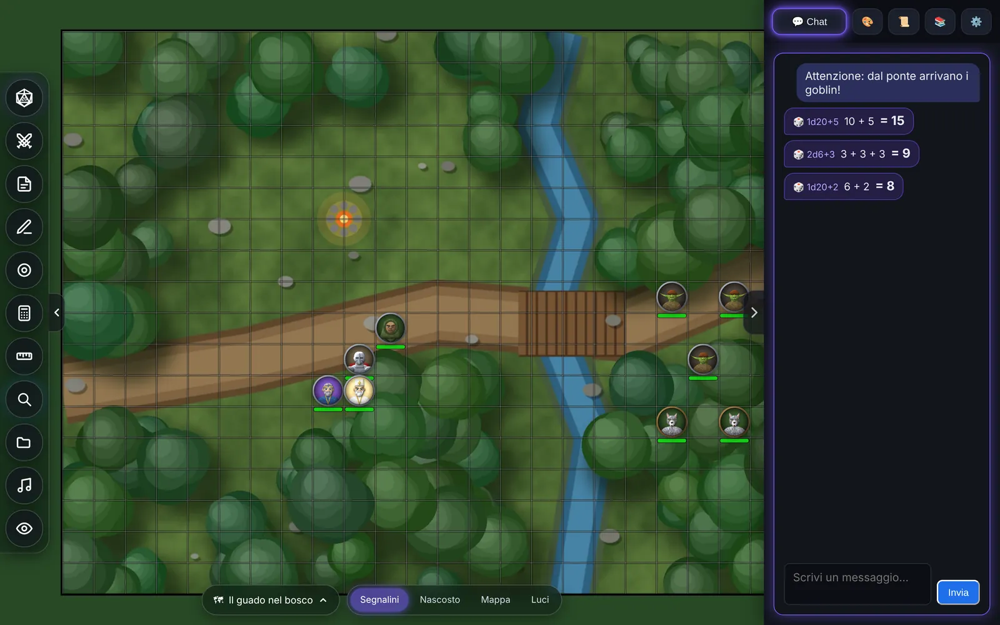
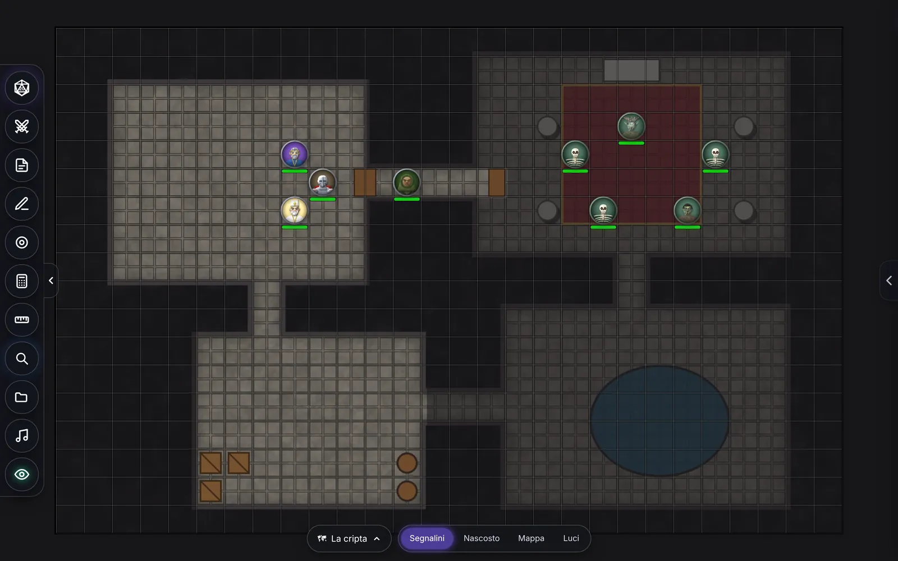
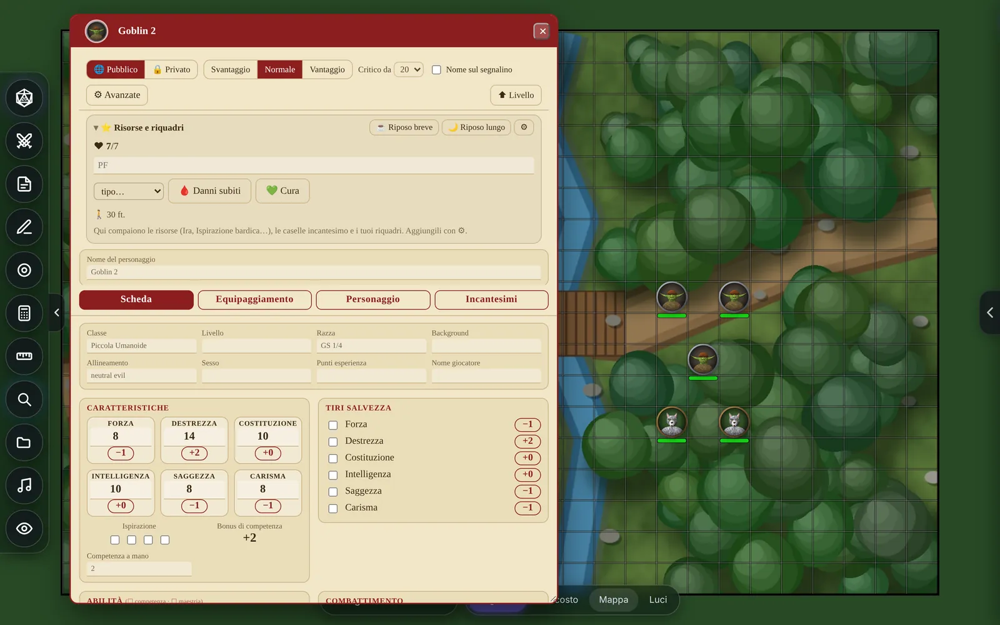

# LIBRE VTT

**English** · [Italiano](README.it.md)

🌐 **Website: [libre-vtt.pages.dev](https://libre-vtt.pages.dev)** — players join from the browser, nothing to install.

## Download

Click a button to download that file from the latest version. The number is how many times it has been
downloaded.

| System | Pick this one | Works everywhere (bigger) |
|---|---|---|
| **Windows 10/11** |   |   |
| **Mac** (macOS 11+) |   |  |
| **Linux** |    |  |
| **Android** 7+ |  |  |
| **iPhone and iPad** (iOS 15+) |   | |

Not sure which one? On Windows almost every PC is **x64** (ARM64 is for Snapdragon PCs). On a Mac, Apple menu ›
*About This Mac*: «Chip» means **Apple Silicon**, «Processor» means **Intel**. On Linux, `uname -m` tells you.
Almost every phone today is **arm64**. The other release files (`uffa-link-…`, `.sha256`, `SHA256SUMS.txt`)
are used by the app on its own: you never need to download them.

A virtual tabletop that runs on your own computer.

There is also a **website version**: when the master switches on «🌐 Public game» in their app, players join
from the browser with the game code, without installing anything (see [docs/sito-web.md](docs/sito-web.md)).

| Fog of war (the master sees through the veil) | Sheets, linked to the tokens |
|---|---|
|  |  |

Maps drawn for these pictures; the SRD tokens are included in the program.

**Bugs and ideas**: open an [issue](https://github.com/EDG-coder/Libre-VTT/issues/new/choose).
To contribute read [CONTRIBUTING.md](CONTRIBUTING.md); for a security problem
[SECURITY.md](SECURITY.md); for accessibility [ACCESSIBILITY.md](ACCESSIBILITY.md).

The app itself is in Italian and English.

## How to start it

### macOS: `LIBRE-VTT-Mac-AppleSilicon.dmg` or `LIBRE-VTT-Mac-Intel.dmg`

The first is for Macs with an Apple chip (M1, M2…), the second for Intel ones. If you don't know which one you
have (Apple menu › *About This Mac*, «Chip» or «Processor»), `LIBRE-VTT.dmg` works on both but is bigger.

1. Open the **.dmg** and drag **LIBRE VTT** onto **Applications**. Done: everything is inside, no loose folders.
2. The first time, macOS says the app comes from an unknown developer (it is not signed by Apple). Go to
   **System Settings → Privacy & Security**, at the bottom, and press **Open Anyway**. You only do this once.
3. If the Mac has no Node.js, LIBRE VTT asks for permission and downloads it by itself from the official
   site (about 45 MB, checking its integrity). If it is already there, it just uses it.

Campaigns go in **Documents › LIBRE VTT › Campagne**; everything else in
`~/Library/Application Support/LIBRE VTT` and the startup log in `~/Library/Logs/LIBRE VTT`.
Nothing is ever written inside the app, so it also works when launched straight from the .dmg.

### Windows: `LIBRE-VTT-Setup-x64.exe` (or `Installa-LIBRE-VTT-Windows.cmd`)

`LIBRE-VTT-Setup-x64.exe` for almost every PC; `LIBRE-VTT-Setup-ARM64.exe` for ARM PCs (Snapdragon).
`LIBRE-VTT-Setup.exe` works on both but is bigger.

Double-click and **Install**. No administrator rights needed, and nothing needs to be installed first: it works
on a freshly installed Windows. At the end you find LIBRE VTT in the Start menu and on the desktop; you remove it
from *Settings › Apps › Installed apps*. The first time Windows may warn that the file comes from the internet:
«Run anyway» / «More info › Run anyway».

### Linux: `Installa-LIBRE-VTT-Linux-x64.sh` (or `-arm64.sh`, `-riscv64.sh`)

One per processor: `x64` for Intel/AMD PCs, `arm64` for ARM (e.g. 64-bit Raspberry Pi), `riscv64` for RISC-V
(`uname -m` tells you). `Installa-LIBRE-VTT-Linux.sh` contains all of them. It needs `xz` to unpack, which almost
every distribution has (otherwise python3 is enough).

Right-click › *Run as a program* (or `bash Installa-LIBRE-VTT-Linux.sh`). No password, no system packages: at
the end LIBRE VTT is in the applications menu and on the desktop; you remove it from the menu (right-click the
icon › *Disinstalla LIBRE VTT*). With zenity or kdialog (GNOME, KDE…) it uses graphical dialogs, otherwise it
does everything in the terminal.

For a headless machine that only acts as a **dedicated server** (see below):
`bash Installa-LIBRE-VTT-Linux.sh --server`.

### Android and iPhone

- **Android**: open the `.apk` on the phone and allow the installation.
- **iPhone and iPad**: `LIBRE-VTT-Xcode.zip` is a ready Xcode project to open on a Mac (instructions in the
  LEGGIMI.txt inside it). Or install `LIBRE-VTT-iOS.ipa` with Sideloadly or AltStore.

The phone apps are the same program as the computer one: you can host a game, join someone else's or play alone.
With a mouse (or in Samsung DeX, or on an iPad with mouse and keyboard) they work like on a computer; with fingers
they have touch controls.

### Where it installs, and why it does not bother anything else

On Windows and Linux everything goes into **one private folder**:
`%LOCALAPPDATA%\LIBRE VTT` on Windows, `~/.local/share/libre-vtt` on Linux.

    app/        the program
    runtime/    its own Node.js, downloaded from nodejs.org and verified (or already in the installer)
    utente/     settings, the remote link and, if needed, the tools to build it

LIBRE VTT only uses what is in there: it does not look at or touch Node, Rust, Python or anything else installed
on the computer, does not change the PATH, ignores variables like `NODE_OPTIONS` or `RUSTFLAGS` left by other
programs, and if the usual ports (3000, 4000, 4100) are taken by other programs it uses others and remembers
them. Uninstalling removes the whole folder; **the campaigns in Documents › LIBRE VTT stay**.

### The remote link

It is needed for «I'm the GM» and «Join a game». LIBRE VTT gets it like this, the
first time it is needed and after asking:

1. if it is already in the installer (the ones built by GitHub have it), it is ready right away;
2. otherwise it **downloads it ready-made** from the project's «Releases» page on GitHub (`rilascio.json` says
   which one), checking its SHA-256 fingerprint: a few MB;
3. if that is not available, it **builds it on the spot** with private tools: Rust and Zig (which acts as the C
   compiler, so neither Visual Studio nor build-essential is needed) downloaded into the LIBRE VTT folder. About
   200 MB to download and 5-15 minutes, only once.

Apps normally talk to each other directly (iroh). If the network or router blocks that, ⚙ Settings › Advanced
settings › «Connection between apps» lets them go through the relay instead (see [docs/sito-web.md](docs/sito-web.md)).

### Other ways (project folder)

| system | what to open |
|---|---|
| Windows | `avvio/LIBRE VTT.vbs` (the first time it creates `LIBRE VTT.lnk` with the icon in the main folder: then use that) |
| Linux | `avvio/LIBRE VTT.desktop` (or `avvio/avvia-app.sh`) |
| macOS | `avvio/LIBRE VTT.app` (the «bridge» version, see below) |

This way you need **Node** already installed ([nodejs.org](https://nodejs.org), LTS version).

### What happens when it opens

A window without browser bars, with three choices:

- **Play alone** — only this computer.
- **I'm the GM** — opens the game and gives you the code to send to the others.
- **Join a game** — paste the code and you are in.

For «Play alone» and «I'm the GM» it first asks **which campaign** (see below).

The first time you choose «I'm the GM» or «Join a game», one more piece is needed to make the computers talk to
each other. The app tells you, asks for permission (it also tells you how much space it takes) and then does
everything by itself: downloads Rust if missing, compiles, and picks up where you were. It takes a few minutes,
**only once per computer**. No terminal, no commands.

> On Windows, if compiling stops, the *Visual Studio C++ Build Tools* are usually missing: the window tells you,
> with the link. You install them once and that's it.

Closing the window shuts everything down. If you open LIBRE VTT again while it is already open, it shows the
existing window instead of starting another one.

### `LIBRE VTT.app` in the folder: a «bridge» (macOS)

If you use the folder instead of the .dmg: you can keep `LIBRE VTT.app` where it is or drag it into
**Applications**. If you move it, **the first time** it asks where the game folder is and remembers it. If you
then unpack a new version, **«avvio/Cambia cartella collegata (macOS).command»** makes it forget the old one. If
clicking it does nothing at all, the zip lost the execute permission: in Terminal type `chmod +x ` + drag
`LIBRE VTT.app` + `/Contents/MacOS/libre-vtt`, Enter, only once. The log is `libre-vtt-avvio.log` in the game
folder.

### If you prefer doing it by hand

The older launchers are still in `avvio/`: `start.command` / `start.bat` (alone), `avvia-master.*` and
`avvia-giocatore.*` (remote), and the classic `node server/server.js`
(`CAMPAIGN_DIR=/path/to/campaign node server/server.js` to use a campaign).
With npm: `npm start` (the table alone, like `start.*`), `npm run app` (the start window) and `npm run server`
(the dedicated server).

## Campaigns

A campaign is **a folder**: inside there are `data/` (scenes, sheets, chat, players and permissions) and
`assets/` (the images). When you start «Play alone» or «I'm the GM» you pick:

- one of the **recent** ones (the last used at the top, with how many scenes, sheets and images it has);
- **＋ New campaign**: give it a name and it goes into *Documents › LIBRE VTT › Campagne*;
- **📂 Open a folder…**: any folder, for example a campaign a friend gave you on a USB
  stick. Whoever opens it **is its master**; the previous players, if they come back, find their sheets again
  (they are recognised by their computer, not by their name).

To hand a campaign to someone, just copy the folder (📂 in the list opens it in Finder or Explorer). «✕» only
removes it from the list: the folder stays where it is. If you pick a folder that is not a campaign it asks
first, and only adds `data/` and `assets/` without touching anything else. The campaign you had before campaigns
existed (inside the game folder) shows up in the list as «The previous campaign».

## Plugins

Themes, compendium packs and new features made by anyone. They live in **Documents › LIBRE VTT › Plugins** (one
folder per plugin, with a `plugin.json` inside) and are managed from the ⚙ gear on the home screen:
*Settings › Plugin › Manage plugins*. A tick applies them to the table, even while it is open; the arrows set the
order; *＋ Create* starts from a ready template. The code runs in a sandbox without internet, unless the plugin
asks for full access: in that case LIBRE VTT applies it only after two warnings. How to make one:
[docs/plugins.md](docs/plugins.md).

## If the connection drops

If the link drops while the app is open (wifi, laptop asleep, the master restarting), a «reconnecting» notice appears at the top and LIBRE VTT keeps trying **until it comes back**, with no limit on
attempts. When you are back you have the same name, the same permissions and the same sheets. Meanwhile you stay
a player: you do not become master by mistake, and the chat warns you instead of losing messages.

It only stops retrying if **you disconnected yourself** (Settings → Session → *Disconnect*, or *Stop* in the
notice) or if the master removed you. *Connect now* puts you back in. The pieces behind the scenes (server, link)
also restart by themselves if they stop.

## Dedicated server (an always-on machine, no screen)

To keep the game always open, like a website, but at home: a small board that uses a few watts (64-bit ARM or
RISC-V, for example a Raspberry Pi or an Orange Pi), an old laptop or a server. Only the part that **connects**
runs there: the campaign, the game server and the remote link. Nobody plays from there: **everyone**, master
included, joins from their own LIBRE VTT with «Join a game» and the game code.

    bash Installa-LIBRE-VTT-Linux.sh --server      # or, from the project folder:
    node server/server-dedicato.js                 # (npm run server)

At startup it prints two things: the **game code** (to send to everyone) and the **master key**. The master, the
first time, opens *I'm the GM on a dedicated server* in «Join a game» and types the key under the code: the server makes them master and from then on recognises them by their signed
identity, without the key. From their **session panel** the master can also give the master role to others (the
server always keeps at least one master). Without the key, or with a wrong one, you join as a player. Whoever sits
at the server machine does not become master.

The master joining from outside takes **the server's world** (scenes, sheets, notes, turns, game system) and edits
it from there; the compendium is the one of the campaign on the server, seen the way players see it. To bring a
campaign you already played onto the server, copy its folder (*Documents › LIBRE VTT › Campagne › name*) and
start with `--campagna <folder>`: the images the world refers to are put in the store at startup.

Useful commands (with the installer: `~/.local/share/libre-vtt/avvia-server <command>`):

| command | what it does |
|---|---|
| `codice` | the game code |
| `chiave` / `nuova-chiave` | the master key / a new one (the old one stops working; whoever is already master stays master) |
| `giocatori` | who is in the register, with their role and who is connected |
| `master <name>` / `giocatore <name>` | gives or removes the master role (even while the server is running) |

Options: `--campagna <folder>` (default `~/libre-vtt-server`), `--porta`, `--porta-link`,
`--collegamento <uffa-link>`. It finds the link in the installation, or downloads it from the releases page,
checking its fingerprint. With the installer it starts by itself as a user service
(`systemctl --user status libre-vtt-server`); to make it start at boot even without logging in:
`sudo loginctl enable-linger $USER`, only once.

## Building the installers

### With GitHub (recommended): everything inside, nothing to download for whoever installs

1. Put the project folder on GitHub (the `.gitignore` file keeps your campaigns and images out).
2. On GitHub: *Releases › Draft a new release*, type a tag starting with «v» (e.g. `v3.0`) and press *Publish*.
3. *Actions* does the rest (about 15 minutes): it compiles the remote link for Windows (x64 and ARM), Linux (x64,
   ARM and RISC-V) and Mac, and puts in the release `LIBRE-VTT-Setup.exe`, `Installa-LIBRE-VTT-Linux.sh`,
   `Installa-LIBRE-VTT-Windows.cmd` and `LIBRE-VTT.dmg`, each with Node and the link inside, plus a lighter version
   for each processor (`LIBRE-VTT-Setup-x64.exe`, `LIBRE-VTT-Mac-AppleSilicon.dmg`,
   `Installa-LIBRE-VTT-Linux-arm64.sh`…). From then on the apps download the link from this release.

Without a tag (*Actions › Rilascio › Run workflow*) it builds everything anyway and leaves it downloadable from
the run's page, without publishing.

### By hand

- `python3 pacchetti/installer/crea-installer.py` → `installatori/` with the Linux installer and the Windows one
  (`.cmd`). These download Node during installation.
- **Mac, on a Mac**: double-click `pacchetti/mac/Crea il DMG.command` (compressed dmg, with Node and, if Rust is
  there, the link already compiled).
- **Mac, without a Mac**: `python3 pacchetti/mac/crea-dmg-senza-mac.py` (ISO 9660 image with Rock Ridge, which
  macOS opens like a .dmg).

## How it is built inside

| piece | what it does | where |
|---|---|---|
| `server/launcher.js` | the start window, turns the rest on and off | `127.0.0.1:4100` |
| `server/server.js` | serves the VTT files and the images | `127.0.0.1:3000` |
| `server/game-server.js` | **decides**: permissions, dice rolls, who sees what | `127.0.0.1:4000` |
| `server/server-dedicato.js` | the dedicated server: game server and link, no windows | — |
| `pacchetti/uffa-link` | carries bytes from one machine to another with iroh | `127.0.0.1:4010` |
| `relay/` | the relay for the website version (Cloudflare Workers) | — |

### The project folders

| folder | what is inside |
|---|---|
| `avvio/` | the launchers to use the project as it is (`.vbs`, `.desktop`, `.app`, `start.*`, `avvia-*`) |
| `server/` | the programs that run with Node: launcher, table, game server |
| `condiviso/` | code used by both the server and the browser (dynamic light, SVG cleaning, world versions) and, in `token-srd/`, the SRD monster tokens: they stay here because saved campaigns refer to them with this path |
| `web/` | the pages: `index.html` (the table), `launcher.html`, `panel.html`, the icons |
| `web/css/` | the styles |
| `web/js/base/` | the heart of the table: map, tools, network, phone, languages |
| `web/js/mappa/` | fog, dynamic light, scene thumbnails, tokens |
| `web/js/strumenti/` | music, notes, turn order |
| `web/js/schede/` | character sheets, PDFs, Roll20, guided creation, rolls |
| `web/js/regole/` | the game systems and the compendium |
| `web/lib/` | third-party libraries (pdf-lib, pdf.js) |
| `sistemi/` | the ready game systems (5e SRD 5.1 and 5.2, empty) with their compendium |
| `examples/plugins/` | the plugin templates (empty, theme, sandbox, full access) used by «＋ Create» |
| `plugins-inclusi/` | the plugins built into the phone apps (empty for now) |
| `docs/` | the plugin guide, the website version, the README images |
| `relay/` | the relay of the website version |
| `assets/` | the welcome background |
| `pacchetti/` | what is needed to build the installable versions: `installer/`, `mac/`, `mobile/`, and the `uffa-link/` link |
| `sviluppo/` | tools for developers (the SRD rules converter, the website) |

**The names.** The program is called LIBRE VTT; it used to be called «MY VTT». Environment variables are now
called `LIBRE_*`: the old ones, `MYVTT_*`, still work, so scripts and apps already installed keep working. Some
identifiers keep the old name on purpose, because changing them would make updating users lose something: the Mac
app identifiers (`local.myvtt.*`: macOS would ask for permissions again), and the «MY VTT» folders that the
installer moves only once. The remote link is called `uffa-link` and speaks the `uffa-vtt/1` protocol: with a new
name older versions would no longer find the file to download and could not play with new ones, so it stays.

Most names in the code and in the folders are Italian; the interface is translated with `tr()` (see
[CONTRIBUTING.md](CONTRIBUTING.md)).

The browser only ever talks to its own computer. The game server is the only true source of the data: the browser
**asks**, the server **decides**. If a player tampered with their page they would get nothing, because what they
must not see is simply never sent to them.

Images (maps, tokens) live in a content-addressed store: the master uploads one only once, the world refers to it
by its hash, and the player's computer gets it from the host and keeps it. Next time it is already there.

## The session panel (usually port 4000)

It only opens from the computer it runs on. From there the master:

- copies the session **ID**;
- chooses **which scene the players see**;
- sets the **entry rules**: session locked, approval before letting someone in, maximum number of players,
  everything paused;
- for each player sees **latency, how long they have been connected, which scene they are looking at, where
  their view is, last action, how many requests they made, which program they joined with**;
- for each player decides the role, **every single permission**, and which **sheets** they can read or edit;
- takes action: **mute** (no chat), **freeze** (sees but cannot touch), **ban** (cannot come back), **force a
  name**, send a **private message**, reset the role's permissions, or disconnect them;
- reads the **log**: everything each person asked the server, including refused requests, with the reason.

Permissions stay saved even after turning everything off: each person is recognised by a token the server gives
them the first time, not by the iroh ID (which changes at every start).

## What a player can do

On their own: write in chat, roll dice, ping, move **their own** tokens, create a token for **their own**
character, and use a picture from their own computer **only** as a token (it travels inside the data, it does not
end up in anyone's assets).

On their own they **cannot**: see the other scenes, see the hidden layer, look under the fog (for them it is solid
black, and covered tokens are not even sent to them), upload images to the shared assets, change scene or grid,
open other people's sheets, choose the music, or touch any setting that affects others.

The master can grant any of this to anyone, item by item, from the panel.

## Dice

The server rolls them with a cryptographic generator, not the browser. Absurd expressions (`500d20`, huge
modifiers) are refused.

- **Advantage / Disadvantage** (in the dice tray): the d20 of any roll — the dice buttons, the sheets' quick rolls,
  `/r` in chat — becomes two d20s and keeps the higher or the lower. Damage does not change. For one roll only:
  **Shift+click** = advantage, **Alt+click** = disadvantage. When it is on, «V» or «S» appears on the dice icon.
- **🔒 Only me and the GM**: only you and the master see the result; the others just get «secret roll», with
  no numbers and no roll name (they never even leave the host's computer). Also useful to the master for hidden
  checks.
- You can also type: `2d20kh1+5` (keep the highest), `2d20kl1` (the lowest), `4d6kh3`.

## Music

The master pastes a YouTube link, or picks songs from their computer, and it plays for everyone. The **volume is
each person's own**: it stays in their browser and does not travel.

## The view

Everyone pans and zooms **their own** map (right-click and drag, wheel to zoom) without touching anyone else's:
when the master moves something, you get the tokens but your framing stays where you put it. If you reload the
page you find it the same.

## Where the data goes

Everything inside the campaign folder:

    data/board.json     the scenes (the master's)
    data/sheets.json    the sheets
    data/world.json     the game server's authoritative world
    data/players.json   roles, permissions and assigned sheets
    data/assets/        the images sent to the players (by hash)
    assets/             the image library
    campagna.json       the campaign name

## Ports

Usually: 4100 the start window, 3000 the table, 4000 the game server and the panel, 4010 the link. If one is taken
by another program, the launcher picks another free one, writes it in the log and remembers it for next time (so
the browser does not forget who you are). By hand: `PORT=4001 node server/game-server.js host`, and in the VTT
change the port in Settings → Session.

## License

[AGPL-3.0](LICENSE). The SRD content is used under its license (see `condiviso/token-srd/SRD_ATTRIBUTION.txt`).
